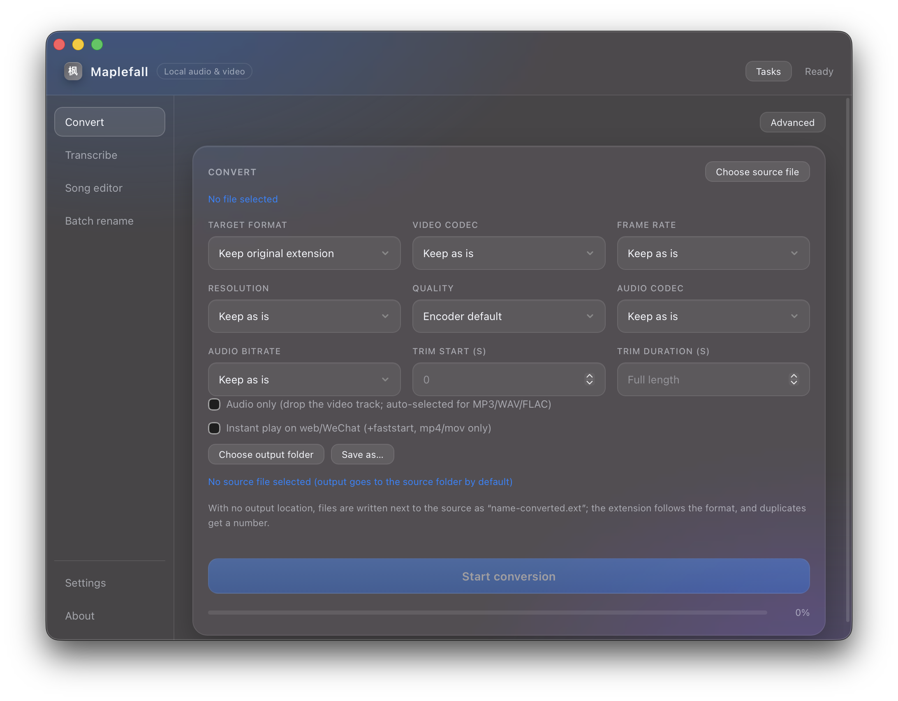

# Maplefall

A local audio/video utility for batch processing: format conversion, speech transcription with whisper.cpp (TXT / SRT / LRC), song renaming and tag editing, vocal separation with MDX-Net. Built for handling files in bulk and getting them tidy, with more features added as needed.

It also ships an MCP server, so agents and scripts can drive transcription and separation directly — over a local HTTP endpoint while the app runs, or through a standalone stdio binary.

**English** · [<u>简体中文</u>](README.zh.md)



## Download and install

Get the latest build from [Releases](https://github.com/flwllu/Maplefall/releases/latest).

- `Maplefall_0.1.0_aarch64.dmg` — Apple Silicon (M-series). This build does not run on Intel Macs.
- Check the download with `shasum -a 256 Maplefall_0.1.0_aarch64.dmg` and compare against `b0c93de55355b493c152b484b415731f29534f37ec0a3be867f4f6c2b7bec121`.

Release builds are **ad-hoc signed, not notarized by Apple**, so macOS blocks the first launch. Open it once with either:

- Right-click the app in Finder → **Open** → confirm, or
- `xattr -dr com.apple.quarantine /Applications/Maplefall.app`

FFmpeg, whisper-cli and the MDX model are bundled — there is nothing else to install.

## Features

**Format conversion**

- Video/audio codec, bitrate, CRF, resolution, frame rate, pixel format, filters, trim range
- Codec and preset lists are read from the bundled ffmpeg's own capabilities at runtime (it falls back to a built-in common set when ffmpeg cannot report them)
- Two-pass, faststart, metadata carrying and extra ffmpeg arguments, with live progress and cancel

**Transcription**

- Drop in or pick any audio/video file and transcribe it: no extension whitelist any more — ffprobe decides whether the file has an audio track (so `.MOV` or `.MKV` are fine), and a missing track is reported clearly
- **Separate vocals first**: run MDX-Net over a song, then feed only the vocal stem to whisper. Lyric accuracy improves dramatically (raw mixes often come back as nothing but punctuation; the separated stem yields full lyrics)
- Export results as TXT / SRT / LRC
- A dedicated "Advanced" panel: initial prompt, beam size, temperature fallback, and more — changes are saved automatically
- Live progress for both separation and transcription

**Audio tools** (the original Python "music toolbox" has been rewritten in Rust and merged in; the old source is archived under `legacy/music-python` — that prototype depends on GPL-2.0 `mutagen` and PyAV, it is a historical archive only, is not packaged, and is not covered by this project's MIT license)

- **Audio info**: format, duration, size, bitrate, sample rate, channels, tags at a glance
- **Edit tags**: title / artist / album / albumartist / genre / date / tracknumber / composer
- **Lyrics**: import LRC / SRT / VTT / TXT (UTF-8 / GBK) or edit directly, saved into file metadata
- **Cover art**: read, write and remove embedded covers
- **Rename**: rename a single file, or auto-fill from "Artist - Title"
- **Batch rename**: process a whole folder with a template

## Requirements

- Installed app: macOS works out of the box; Linux and Windows have the code and bundle config in place, but need `whisper-cli` / `ffmpeg` binaries supplied separately (see `docs/PORTABILITY-LINUX.md`, `docs/PORTABILITY-WINDOWS.md`), not verified yet
- Building from source: the repo ships **no binaries** (`whisper-cli`, `ffmpeg`); get them as described in "Binaries for source builds" under [What to upload](#what-to-upload) — or just rely on the system `ffmpeg`
- Node 18+ and npm
- Rust toolchain (1.92+), with `~/.cargo/bin` on your PATH
- The installed app has no external runtime dependencies: static FFmpeg / ffprobe, whisper-cli and the MDX model all ship inside the bundle
- To swap the MDX model, point the `UVR_MODEL_PATH` environment variable at another ONNX file

## Running (dev)

```bash
cd whisper-studio
npm run dev
```

This is equivalent to `tauri dev`: it builds a debug binary and opens the native window without packaging.

- If cargo is not found: `export PATH="$HOME/.cargo/bin:$PATH"`
- Editing Rust code under `src-tauri/` triggers a rebuild and restart; editing frontend files under `src/` hot-reloads the window
- To stop: `Ctrl+C` in the terminal
- `npm run build` produces a dmg — not for day-to-day development

## Packaging

Double-click `build.command` in the project root (or run `./build.command` in a terminal). A native macOS dialog lets you pick the package variant; no extra tools are installed and `tauri.conf.json` is never modified:

- **Slim** (default distribution): leaves out the encoder (~640 MB). whisper-cli is compiled with `WHISPER_COREML_ALLOW_FALLBACK`, so when the encoder is missing it falls back to Metal + CPU and transcription still works, just slower.
- **Full**: only meaningful once you have built the CoreML encoder yourself (~1.7 GB). The repo does not ship it — see "CoreML encoder (build it yourself)" below.

The script passes a temporary resource list via `tauri build --config` and removes it afterwards. The dmg still lands in `src-tauri/target/release/bundle/dmg/`.

## Layout

```
src/                      Frontend, plain HTML/CSS/JS (no build step)
src-tauri/src/main.rs     Tauri commands: list_models / transcribe / save_text
src-tauri/src/mdx.rs      MDX-Net vocal separation
src-tauri/resources/bin/  whisper-cli and its dynamic libraries; ffmpeg/ holds static ffmpeg + ffprobe
src-tauri/resources/models/
    ggml-large-v3-turbo-q5_0.bin         547 MB, main model
    ggml-large-v3-turbo-encoder.mlmodelc 1.2 GB, CoreML encoder (build it yourself, not in the repo)
```

## Transcription parameters

- Always passes `--print-progress` and `--entropy-thold 2.8`; thread count is half the CPU core count
- "Suppress non-speech" maps to `--suppress-nst`; "No context" maps to `-mc 0`
- Note: when an initial prompt is set, `-mc 0` is no longer passed, otherwise the prompt gets swallowed (see the comment in `main.rs`)
- The advanced fields map to whisper.cpp's `-bs` / `-bo` / `-nth` / `-et` / `-lpt` / `-wt` / `-ml` / `-nf` / `--carry-initial-prompt`

## How vocal separation works

- Model: `UVR-MDX-NET-Inst_HQ_3.onnx` (64 MB), bundled under `resources/models/`
- Lookup order: `UVR_MODEL_PATH` env var > bundled resource > local UVR install (legacy fallback)
- Parameters: 44.1 kHz, n_fft 6144, hop 1024, dim_f 3072, 256 frames per chunk (chunk 261120 samples), overlap 0.25 — matching UVR's "Segment 256 / Overlap Default"
- Pipeline: peak normalization → chunked STFT (periodic Hann) → ONNX inference produces the instrumental spectrum → iSTFT overlap-add → vocals = original − instrumental → write a 16-bit mono wav for whisper
- Measured: a 2:57 song separates in about 76 s (debug build); the instrumental correlates with UVR's official output at 0.964

## MCP server

Two entry points, sharing one set of tool implementations:

- **In-app HTTP endpoint (recommended)**: while whisper-studio is running it listens on `http://127.0.0.1:17321/mcp`. Closing the app removes it, leaving no background process behind. Each request spawns `whisper-studio-mcp` for the duration of the call and exits immediately afterwards.
- **Standalone stdio binary**: `cargo build --bin whisper-studio-mcp`, output at `src-tauri/target/debug/whisper-studio-mcp`, for clients that want to work without the GUI.

The "Enable MCP server" switch in settings turns the HTTP endpoint on/off instantly: turning it off releases the port and clients show as disconnected; turning it back on restores it without a restart. The state is stored as `mcpEnabled` in `settings.json` (default `true`).

Client config (HTTP):

```json
{
  "mcpServers": {
    "whisper-studio": {
      "type": "http",
      "url": "http://127.0.0.1:17321/mcp"
    }
  }
}
```

Exposed tools:

| Tool | Purpose |
|---|---|
| `transcribe_audio` | Transcribe audio/video, returns `text` and `srt`; accepts model, language, separate, vad, suppress_ns, prompt |
| `separate_vocals` | Separate vocals with MDX, returns the wav path; results are cached in the system temp dir |
| `list_models` | List available whisper models |
| `get_settings` / `save_settings` | Read/write the app's `settings.json` (atomic writes) |

Notes:

- The HTTP endpoint is unavailable when the app is not running; clients will show "not connected". That is by design.
- Tools are synchronous and blocking, so long audio may hit client timeouts — prefer short clips or already-separated vocals.
- The resource directory is always resolved at runtime from the executable's location (`Contents/Resources/resources` in release builds; walking up from `target/debug` in development), no machine-specific absolute path is compiled in — moving the repo or switching machines needs no rebuild. Set `WHISPER_STUDIO_RESOURCES` to override it explicitly.
- In stdio mode stdout carries protocol traffic only; all logs go to stderr.

## Task queue

Both GUI transcription and MCP's `transcribe_audio` go through one task queue: callers get a `task_id` immediately without waiting for transcription to finish, and the queue dispatches up to the concurrency limit. Each task runs in its own `whisper-studio-mcp` child process — ONNX Runtime allows only one environment per process, so process isolation is what makes parallel transcription possible.

- **Task window**: the "Tasks" button in the top-right opens a separate window listing every task's status, progress and source; queued/running tasks can be cancelled, and double-clicking a task opens a detail window with the transcript and TXT/SRT export. The button badge shows the active task count.
- **Concurrency**: defaults to 2, adjustable in Settings or the task window (1–100). Each task loads ~550 MB of model/encoder, so high values eat memory and CPU; a confirmation prompt guards large values.
- **Hardware acceleration**: a CoreML switch in Settings. It is only usable when the selected model has a `*-encoder.mlmodelc` beside it; otherwise the switch is greyed out. Turning it off makes whisper-cli use Metal + CPU — same output, slower but quicker to start and lighter on memory. Stored as `coreml` in `settings.json` (default `true`); the MCP equivalent is `acceleration` on `transcribe_audio`.
- **Persistence**: tasks and the concurrency setting are saved to `tasks.json` beside `settings.json` and restored on restart; tasks still running/queued when the app closes are marked "interrupted". "Clear tasks" in the task window opens a confirmation dialog: it removes finished/failed/cancelled/interrupted records (running and queued ones stay, cancel them first), with a checkbox to also wipe artifacts — separation cache, temporary transcript output and run logs, all inside the app data dir and regenerable, never your own output files.
- **Close confirmation**: closing the window or quitting while work is still running — queued/running tasks, an in-progress conversion or transcription — asks once first, and confirming kills the child processes instead of orphaning them. With nothing running it just closes.
- **Progress**: the child process does not stream per-frame progress, so a task's progress updates at start/finish (0% → 10% → 95% → 100%).
- **MCP task tools**: `transcribe_audio` returns a `task_id` immediately; `list_tasks` lists all tasks, `get_task` returns one task (incl. text/srt/log), `get_task_log` (arg `id`) returns just that task's log, and `cancel_task` (arg `id`) actually kills the running child process and cancels the task. All are intercepted by the in-app HTTP layer and appear in `tools/list`.
- **Per-task logs**: each task stores its own run log (stages, whisper output lines, progress) in the `log` field, persisted to `tasks.json`. The MCP child writes logs/progress to stderr as `@@L:`/`@@P:` markers, which the manager reads in real time — so progress is continuous (separate 0–60%, transcribe 60–100%) instead of sticking at 10%. The detail window shows the task's log with a copy button; the main page no longer shows a run log.

## Debug logs

Turn on "Debug log" in Settings and every transcription (plus app startup and MCP toggles) writes its own `.log` file under the `runs` folder in the app log directory, capturing arguments, every whisper-cli output line, progress and the reason for failures. The same page shows the path and has a button to open the folder. Off by default; no files are written while off. Logs may contain local file paths and can be deleted after troubleshooting.

## Disk usage

- `src-tauri/target` is about 4 GB (debug build plus copied resources) and can be rebuilt any time with `cargo clean`
- `[profile.dev] debug = 1` in `Cargo.toml` keeps only line-level debug info, avoiding bloated debug symbols
- `bundle.resources` currently lists `resources/bin/whisper_cpp/**`, `resources/bin/ffmpeg/*`, `resources/models/*.bin` and `resources/models/*.onnx` — required for the dmg build (static ffmpeg and ffprobe are ~48 MB each). In debug builds the backend prefers the in-repo `resources`, but Tauri still copies these resources into `target/debug`, which is the main source of disk usage

## Known limitations

- No mobile support yet: it depends on an external `whisper-cli` process, so mobile would need a static library
- Non-44.1 kHz input is resampled with linear interpolation: fine for transcription, but quality-critical use needs a better resampler
- Models can only be swapped through `UVR_MODEL_PATH`; there is no in-app model picker yet

## What to upload

Two destinations: **the repo carries source only, binaries and models ship inside the Release installer**.

### Repository (~3 MB)

| Contents | Size | Notes |
| --- | --- | --- |
| Source and project config | small | `src/`, `src-tauri/src/`, `src-tauri/icons/`, `src-tauri/capabilities/`, JSON configs |
| `src-tauri/resources/licenses/` | 30 KB | GPL-2.0 full text and third-party notices — plain text that ships with the bundle |

The repo carries **no binaries**: no `whisper-cli`, no `ffmpeg`/`ffprobe`. Two reasons — size (96 MB and up), and FFmpeg being GPL-2.0-or-later: committing that binary makes license scanners classify the whole repo as GPL. A source repo should be MIT and nothing else.

**Also not included**: `resources/models/*.bin`, `*.onnx` (~611 MB together, above GitHub's 100 MB per-file limit), `*.mlmodelc`, `target/`, `node_modules/`, `gen/schemas/`, logs and internal dev notes — all excluded by `.gitignore`. See the two sections below for getting binaries and models when building from source.

### Binaries for source builds

Skip this if you use the installer — the binaries are already inside the `.app`. The repo does not carry them, so a source build needs:

| Tool | Where it goes | How to get it |
| --- | --- | --- |
| `ffmpeg`, `ffprobe` | `src-tauri/resources/bin/ffmpeg/` | Any static build; or skip it entirely — the code falls back to `ffmpeg` from `PATH` (e.g. `brew install ffmpeg`) |
| `whisper-cli` plus `libggml*` / `libwhisper*` | `src-tauri/resources/bin/whisper_cpp/` (flat on macOS) | Build it from [whisper.cpp](https://github.com/ggml-org/whisper.cpp); turn on upstream's `WHISPER_COREML_ALLOW_FALLBACK` so it still runs without the CoreML encoder |

Directory conventions for Linux/Windows are in `docs/PORTABILITY-LINUX.md` and `docs/PORTABILITY-WINDOWS.md`. The full/slim choice in `build.command` only controls the CoreML encoder and the MDX model — missing binaries fail at runtime with "whisper-cli not found".

### Release (full package)

Attach `src-tauri/target/release/bundle/dmg/*.dmg` (~640 MB, models already bundled) plus its `.sha256` checksum. Users install and run — no model setup needed.

The models remain **third-party works**; see the per-file notice inside the app bundle (`Contents/Resources/resources/models/README.md`) and [`THIRD_PARTY_NOTICES.md`](THIRD_PARTY_NOTICES.md).

### Models: where to get them, how to configure

Building from source needs three files in `src-tauri/resources/models/`:

| File | Official source | Size | SHA-256 |
| --- | --- | --- | --- |
| `ggml-large-v3-turbo-q5_0.bin` | [ggerganov/whisper.cpp](https://huggingface.co/ggerganov/whisper.cpp) (ggml quantized) | 547 MB | `394221709cd5ad1f40c46e6031ca61bce88931e6e088c188294c6d5a55ffa7e2` |
| `ggml-silero-v5.1.2.bin` | [ggml-org/whisper-vad](https://huggingface.co/ggml-org/whisper-vad) | 865 KB | `29940d98d42b91fbd05ce489f3ecf7c72f0a42f027e4875919a28fb4c04ea2cf` |
| `UVR-MDX-NET-Inst_HQ_3.onnx` | [TRvlvr/model_repo](https://github.com/TRvlvr/model_repo/releases/tag/all_public_uvr_models) (UVR's official model repo) | 64 MB | `317554b07fe1ea5279a77f2b1520a41ea4b93432560c4ffd08792c30fddf9adc` |

If `huggingface.co` is unreachable, use the `hf-mirror.com` mirror — same paths, different host (the commands below use it):

```bash
cd src-tauri/resources/models

curl -L -o ggml-large-v3-turbo-q5_0.bin \
  https://hf-mirror.com/ggerganov/whisper.cpp/resolve/main/ggml-large-v3-turbo-q5_0.bin

curl -L -o ggml-silero-v5.1.2.bin \
  https://hf-mirror.com/ggml-org/whisper-vad/resolve/main/ggml-silero-v5.1.2.bin

curl -L -o UVR-MDX-NET-Inst_HQ_3.onnx \
  https://github.com/TRvlvr/model_repo/releases/download/all_public_uvr_models/UVR-MDX-NET-Inst_HQ_3.onnx

shasum -a 256 *.bin *.onnx   # compare with the table above
```

Configuration:

- **Default**: drop the files into `src-tauri/resources/models/` — nothing else to configure. In a packaged app that path is `.app/Contents/Resources/resources/models/`.
- **Keep resources elsewhere**: `WHISPER_STUDIO_RESOURCES=/path/to/resources` (that directory must contain `models/` and `bin/`).
- **Swap the separation model**: `UVR_MODEL_PATH=/path/to/xxx.onnx` pointing at any MDX-Net ONNX.
- **If a file is missing**: no main model → transcription unavailable; no `ggml-silero-*.bin` → the VAD option is disabled; no `*.onnx` → vocal separation unavailable, transcription and conversion still work.

### Supported models: drop them in, they show up

The model dropdown merges **two directories** (duplicates removed):

| Directory | Location | Purpose |
| --- | --- | --- |
| User directory (recommended) | macOS `~/Library/Application Support/com.whisperstudio.desktop/models/`<br>Windows `%APPDATA%\com.whisperstudio.desktop\models\`<br>Linux `~/.local/share/com.whisperstudio.desktop/models/` | Add or remove your own models freely; never touches the app signature |
| Bundled directory | `src-tauri/resources/models/` (`Contents/Resources/resources/models/` once packaged) | Ships with the installer |

The "模型文件夹 / Models folder" button opens the user directory. After adding or deleting a file, switching back to the window refreshes the list — no restart. If both directories contain the same name, **the user directory wins**.

Only files matching all of the following are listed; everything else is ignored:

1. **ggml-format** whisper weights (whisper.cpp `.bin`). OpenAI's original `.pt` / `.safetensors` and CoreML `*.mlmodelc` are not part of this list.
2. File name ends with **`.bin`**; the rest of the name is arbitrary (`ggml-small.bin`, `my-model.bin` both work).
3. Names containing **`silero`** are treated as the VAD model and excluded from the transcription list.

Grab `ggml-*.bin` straight from [`ggerganov/whisper.cpp`](https://huggingface.co/ggerganov/whisper.cpp) on Hugging Face (same path on the `hf-mirror.com` mirror). Common choices:

| Model | Size | Notes |
| --- | --- | --- |
| `ggml-tiny.bin` / `ggml-base.bin` | ~75 MB / 142 MB | Fastest, lower accuracy — good for a quick test |
| `ggml-small.bin` | ~466 MB | Balanced day-to-day option |
| `ggml-medium.bin` | ~1.5 GB | More accurate, noticeably slower |
| `ggml-large-v3.bin` | ~3 GB | Most accurate, slowest, memory hungry |
| `ggml-large-v3-turbo-q5_0.bin` | 547 MB | The app default: large-v3-level accuracy, much faster |
| any `*.en.bin` | same | English-only; faster and more accurate than multilingual for English audio |

Quantized variants (`-q5_0`, `-q8_0`, …) are smaller and faster with a small accuracy trade-off. The VAD and MDX models are not part of this list: VAD always reads `ggml-silero-v5.1.2.bin`, and separation uses `UVR_MODEL_PATH` or the bundled `*.onnx`.

To ship extra models with the app, drop them into `resources/models/` — they travel with the installer, and the user directory keeps working alongside.

### What must never be uploaded

- `src-tauri/target/`, `node_modules/` and local build caches (e.g. `.codebuddy/tmp/whisper.cpp` inside the workspace) contain absolute paths from the build machine. They are excluded by `.gitignore` and must not be archived into any upload.

- `src-tauri/resources/bin/` (`whisper-cli`, `ffmpeg`, `ffprobe` and dylibs) stays out of the repo as well: the files remain on disk for packaging, `.gitignore` only stops them from being committed.
- Mach-O load commands can embed build-time absolute paths (`LC_RPATH`). Before packaging, spot-check with `otool -l <file> | grep -A3 LC_RPATH`; release binaries should only carry relative entries such as `@loader_path`.
- **Binaries or installers already distributed cannot be recalled.** Once someone has a copy, the build-machine paths inside it are effectively public — only a fresh build and a new release reduces exposure; deleting local files does nothing.
- Sign release artifacts and publish SHA-256 checksums so users can verify provenance.

### CoreML encoder (build it yourself)

The repo does **not** contain `ggml-large-v3-turbo-encoder.mlmodelc`; the default distribution is the slim build that does not need it (falls back to Metal + CPU — fully functional, just slower). To get CoreML acceleration:

1. Clone [whisper.cpp](https://github.com/ggml-org/whisper.cpp) and enter its root;
2. Run its upstream script `./models/generate-coreml-model.sh large-v3-turbo` (needs macOS, Python 3 and `coremltools`);
3. Copy the generated `ggml-large-v3-turbo-encoder.mlmodelc` directory into `src-tauri/resources/models/`;
4. Rebuild with `./build.command` and pick "Full".

Skipping this is fine: `whisper-cli` is compiled with `WHISPER_COREML_ALLOW_FALLBACK`, so it falls back to Metal + CPU when the encoder is absent.

## Privacy

All processing happens on your machine and no usage data is collected. The app itself makes no network requests; the only listener is the built-in MCP server on `127.0.0.1`, which is used only when you connect a client to it. See [`PRIVACY.md`](PRIVACY.md) for details.

## License and attributions

Released under the MIT license (see [`LICENSE`](LICENSE), Copyright © 2026 flwllu).

Bundled packages ship the full GPL-2.0 text and a copy of the third-party notices under `Contents/Resources/resources/licenses/`; the "Third-party licenses" section on the About page opens that folder.

The three-year written offer for the FFmpeg corresponding source is in section 3 of [`THIRD_PARTY_NOTICES.md`](THIRD_PARTY_NOTICES.md): take the official source from ffmpeg.org, or open an issue on the project's code hosting page if that is unavailable.

### Third-party components

| Component | License | Notes |
|---|---|---|
| [FFmpeg](https://ffmpeg.org) / ffprobe | GPL-2.0-or-later (static build with libx264 / libx265) | Media info, tags, covers, format conversion; bundled — see [`THIRD_PARTY_NOTICES.md`](THIRD_PARTY_NOTICES.md) for the source offer |
| [whisper.cpp](https://github.com/ggml-org/whisper.cpp) | MIT | Transcription engine |
| [OpenAI Whisper large-v3-turbo](https://huggingface.co/openai/whisper-large-v3-turbo) | MIT | Transcription weights (ggml quantized and CoreML-converted) |
| [Ultimate Vocal Remover](https://github.com/Anjok07/ultimatevocalremovergui) | MIT | MDX models trained by UVR core developers Anjok07 and aufr33 |
| UVR-MDX-NET-Inst_HQ_3.onnx | MIT (copyright held by the UVR project) | Redistributed unmodified with this app; see the attribution below |
| [ONNX Runtime](https://github.com/microsoft/onnxruntime) / ort | MIT | MDX inference |
| [Tauri](https://github.com/tauri-apps/tauri) | MIT / Apache-2.0 | Application shell |
| [Symphonia](https://github.com/pdeljanov/Symphonia) | MPL-2.0 | Audio decoding (mp3 / aac / flac / ogg, etc.) |
| realfft / rustfft | MIT / Apache-2.0 | STFT |
| hound | Apache-2.0 | WAV writing |

### Model attribution and notice

- **Source**: `UVR-MDX-NET-Inst_HQ_3.onnx` was trained and distributed by the [Ultimate Vocal Remover](https://github.com/Anjok07/ultimatevocalremovergui) project (Anjok07, aufr33 and contributors). This project ships it **unmodified**, neither retrained nor altered.
- **Rights**: this project claims no copyright or ownership over the weights. All rights remain with the UVR project and its authors; the file is redistributed under the upstream MIT terms.
- **Credits**: vocal separation is built entirely on UVR's MDX-Net implementation and models. Our thanks to them.
- **No affiliation**: this is an independent project with no affiliation, sponsorship or endorsement from the UVR project or the model authors. Names are used only to state provenance.
- **Disclaimer**: the model is provided "as is", without warranty of any kind. Rights to input audio and to separated stems remain with their respective owners; users are responsible for ensuring they may legally process the audio.
- **Replaceable / removable**: `UVR_MODEL_PATH` can point at any other ONNX model; delete `resources/models/*.onnx` and rebuild for a build without the weights.

The full notice lives in section 4 of [`THIRD_PARTY_NOTICES.md`](THIRD_PARTY_NOTICES.md).

---

*Development: written and debugged with AI coding assistants — DeepSeek-V4.1 Flash in Trae and CodeBuddy (same model), with Hunyuan also taking part.*

License: MIT © 2026 flwllu
