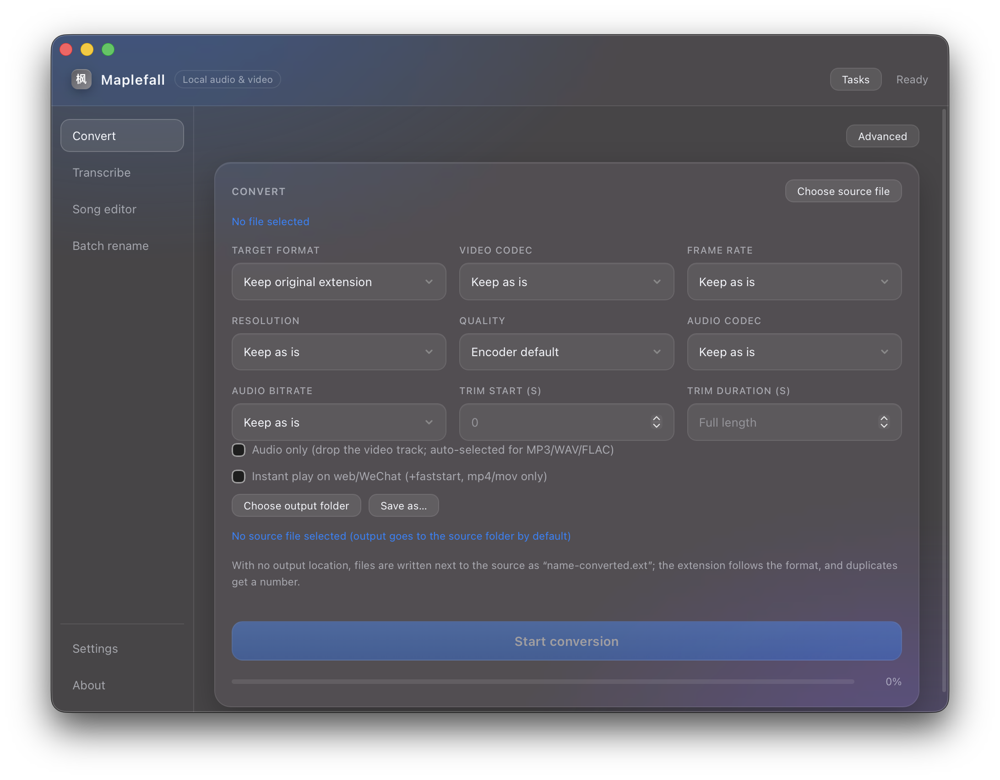

# 枫落工具

本地音视频处理工具，面向批量处理：格式转换、语音转写（识别，whisper.cpp，导出 TXT / SRT / LRC）、歌曲重命名与标签编辑、MDX-Net 人声分离。日常就是成批处理与整理文件，后续按需增加功能。

内置 MCP 服务，AI 客户端与脚本可以直接调用转写与人声分离：应用运行时走本机 HTTP 端点，也可以单独跑 stdio 二进制。

[<u>English</u>](README.md) · **中文**



## 下载与安装

到 [Releases](https://github.com/flwllu/Maplefall/releases/latest) 下载最新版本。

- `Maplefall_0.1.0_aarch64.dmg` —— 适用于 Apple Silicon（M 系列）。此版本无法在 Intel Mac 上运行。
- 可用 `shasum -a 256 Maplefall_0.1.0_aarch64.dmg` 核对，正确值：`b0c93de55355b493c152b484b415731f29534f37ec0a3be867f4f6c2b7bec121`。

发布包为 **ad-hoc 签名、未经 Apple 公证**，首次打开会被系统拦截，任选一种方式放行：

- 在访达里右键点击应用 → **打开** → 确认；或
- 执行 `xattr -dr com.apple.quarantine /Applications/Maplefall.app`

FFmpeg、whisper-cli 与 MDX 模型均已内置，无需另外安装。

## 功能

**格式转换**

- 视频/音频编码、码率、CRF、分辨率、帧率、像素格式、滤镜、裁剪区间
- 编码器与预设列表在运行时从随包 ffmpeg 自身的能力读出来（读不到时回退到内置常用项）
- 支持二遍编码、faststart、元数据保留与追加 ffmpeg 参数，实时进度与取消
- **替换音轨**：导入一个音频替换原音轨（视频轨保持不变）。音频比视频长时按视频长度裁掉多余部分；音频比视频短时保留完整视频，音频播完即止

**转写**

- 拖入或选择任意音视频文件直接转写：不再按扩展名白名单卡，选完由 ffprobe 判断有没有音轨（`.MOV`、`.MKV` 这类大写后缀同样可用），没有音轨会明确告知
- **先分离人声**：对歌曲先跑一遍 MDX-Net，把人声轨交给 whisper，歌词识别率提升明显（原曲转写经常只剩标点，分离后能出完整歌词）
- 结果导出 TXT / SRT / LRC
- 独立「高级参数」面板：初始提示词、beam size、温度回退等，改动自动保存
- 转写、分离过程都有实时进度

**音频工具**（原「音乐工具箱」Python 版已用 Rust 重写并入，源码归档在 `legacy/music-python`；该原型依赖 GPL-2.0 的 mutagen 与 PyAV，只是历史存档，不参与打包，也不在本项目的 MIT 许可范围内）

- **音频信息**：格式、时长、大小、码率、采样率、声道、标签一览
- **编辑标签**：title / artist / album / albumartist / genre / date / tracknumber / composer
- **歌词编辑**：导入 LRC / SRT / VTT / TXT（UTF-8 / GBK 均可）或直接编辑，写入文件元数据
- **封面管理**：读取、写入、删除内嵌封面
- **重命名**：单文件重命名，或用「艺术家 - 标题」自动填充
- **批量重命名**：按模板批量处理文件夹内音频

## 环境要求

- 使用安装包：macOS 开箱可用；Linux / Windows 的代码与打包配置已就绪，但需自行提供 `whisper-cli` / `ffmpeg` 二进制（见 `docs/PORTABILITY-LINUX.md`、`docs/PORTABILITY-WINDOWS.md`），当前未验证
- 从源码构建：仓库**不含**任何二进制（`whisper-cli`、`ffmpeg`），需按「[上传 / 分发清单](#上传--分发清单)」里的「二进制工具」一节自行放入或改用系统安装的版本
- Node 18+ 与 npm
- Rust 工具链（1.92+），确保 `~/.cargo/bin` 在 PATH 里
- 装好的应用运行时不依赖任何外部程序：静态 FFmpeg / ffprobe、whisper-cli 与 MDX 模型全部随包分发
- 如需换成别的 MDX 模型，用环境变量 `UVR_MODEL_PATH` 指定 onnx 路径

## 启动（调试）

```bash
cd whisper-studio
npm run dev
```

等价于 `tauri dev`：编译调试版并直接弹出原生窗口，不打包。

- 如果提示找不到 cargo：`export PATH="$HOME/.cargo/bin:$PATH"`
- 改 `src-tauri/` 下的 Rust 代码会自动重编译重启；改 `src/` 下的前端文件窗口自动刷新
- 停止：终端里 `Ctrl+C`
- `npm run build` 是打包 dmg，日常调试不要用

## 打包

双击项目根目录的 `build.command`（或在终端运行 `./build.command`），会弹出 macOS 原生对话框选打包方案，不需要安装额外工具，也不会改动 `tauri.conf.json`：

- **精简包**（默认分发版本）：不带 CoreML 编码器，约 640 MB。whisper-cli 以 `WHISPER_COREML_ALLOW_FALLBACK` 编译，找不到编码器时自动回落到 Metal + CPU，转写照常工作，只是慢一些。
- **完整包**：只在你自己编译了 CoreML 编码器时才有意义，约 1.7 GB。仓库不附带该编码器，生成方法见下文「CoreML 编码器（自行编译）」。

脚本通过 `tauri build --config` 临时覆盖资源清单，结束后删除临时配置；产物仍在 `src-tauri/target/release/bundle/dmg/`。

## 目录结构

```
src/                      前端，纯 HTML/CSS/JS（无构建工具）
src-tauri/src/main.rs     Tauri 命令：list_models / transcribe / save_text
src-tauri/src/mdx.rs      MDX-Net 人声分离
src-tauri/resources/bin/  whisper-cli 及其动态库；ffmpeg/ 下是静态 ffmpeg 与 ffprobe
src-tauri/resources/models/
    ggml-large-v3-turbo-q5_0.bin        547 MB，主模型
    ggml-large-v3-turbo-encoder.mlmodelc 1.2 GB，CoreML 编码器（自行编译，不随仓库）
```

## 转写参数

- 默认加 `--print-progress`、`--entropy-thold 2.8`，线程数取 CPU 核数的一半
- 「抑制非语音」→ `--suppress-nst`；「不沿用上文」→ `-mc 0`
- 注意：填了初始提示词时后端不再传 `-mc 0`，否则提示词会被吞掉（main.rs 内有注释）
- 高级参数依次对应 whisper.cpp 的 `-bs` / `-bo` / `-nth` / `-et` / `-lpt` / `-wt` / `-ml` / `-nf` / `--carry-initial-prompt`

## 人声分离实现

- 模型：`UVR-MDX-NET-Inst_HQ_3.onnx`（64 MB），随应用打包在 `resources/models/` 下
- 查找顺序：`UVR_MODEL_PATH` 环境变量 > 随包资源 > 本机 UVR 安装目录（旧版回退）
- 参数：44.1 kHz、n_fft 6144、hop 1024、dim_f 3072、每块 256 帧（chunk 261120 样本）、overlap 0.25，对齐 UVR 的「Segment 256 / Overlap Default」
- 流程：峰值归一化 → 分块 STFT（周期 Hann）→ ONNX 推理得到伴奏频谱 → iSTFT 叠接 → 人声 = 原曲 − 伴奏 → 写 16-bit 单声道 wav 交给 whisper
- 实测：2 分 57 秒的歌分离约 76 秒（debug 构建）；伴奏与 UVR 官方输出相关系数 0.964

## MCP 服务器

MCP 有两个入口，共用同一套工具逻辑：

- **应用内 HTTP 端点（推荐）**：whisper-studio 运行时监听 `http://127.0.0.1:17321/mcp`，应用关闭即消失，不留下常驻进程。每个请求临时拉起 `whisper-studio-mcp` 子进程处理，回答完立刻退出。
- **独立 stdio 二进制**：`cargo build --bin whisper-studio-mcp`，产物在 `src-tauri/target/debug/whisper-studio-mcp`，适合希望脱离 GUI 使用的客户端。

设置里的「启用 MCP 服务」开关可以即时开/关 HTTP 端点：关闭后端口立即释放、客户端会显示未连接；再打开即恢复，无需重启。状态持久化在 `settings.json` 的 `mcpEnabled`（默认 `true`）。

客户端配置（HTTP）：

```json
{
  "mcpServers": {
    "whisper-studio": {
      "type": "http",
      "url": "http://127.0.0.1:17321/mcp"
    }
  }
}
```

暴露的工具：

| 工具 | 作用 |
|---|---|
| `transcribe_audio` | 转写音频/视频，返回 `text` 与 `srt`；可调 model、language、separate、vad、suppress_ns、prompt |
| `separate_vocals` | 用 MDX 分离人声，返回 wav 路径，结果缓存在系统临时目录 |
| `list_models` | 列出可用 whisper 模型 |
| `get_settings` / `save_settings` | 读写应用的 `settings.json`（原子写入） |

注意：
- 应用没启动时 HTTP 端点不可用，客户端会显示未连接，这是设计行为。
- 工具是同步阻塞的，长音频可能触发客户端超时，优先传短片段或已分离的人声。
- 资源目录一律在运行时按可执行文件位置推导（发布版在 `Contents/Resources/resources`，开发版从 `target/debug` 向上找），不把本机绝对路径编进二进制；换机器或移动目录无需重新编译。也可用环境变量 `WHISPER_STUDIO_RESOURCES` 显式指定。
- stdio 模式下 stdout 只输出协议，日志一律走 stderr。

## 任务队列

界面转写和 MCP 的 `transcribe_audio` 都走同一个任务队列：调用方提交后立即拿到 `task_id`，不用等转写完成；队列按并发上限调度，每个任务在独立的 `whisper-studio-mcp` 子进程里执行（ONNX Runtime 一个进程只能初始化一次，子进程隔离才能并发）。

- **任务窗口**：主窗口右上角「任务」按钮打开独立窗口，列出所有任务的状态、进度、来源，可取消排队/运行中的任务，双击打开详情窗口查看转写文本并导出 TXT/SRT。按钮上的徽标显示当前活动任务数。
- **并发数**：默认 2，可在设置页或任务窗口调整（1–100）。每个任务要加载约 550 MB 模型和编码器，设太高会吃满内存和 CPU，超过阈值会弹确认提示。
- **硬件加速**：设置页有 CoreML 开关。当前模型旁存在 `*-encoder.mlmodelc` 时才能开；没有编码器时开关置灰。关闭后 whisper-cli 改走 Metal + CPU，识别结果一致，只是慢一些，启动更快也不额外占内存。状态存在 `settings.json` 的 `coreml`（默认 `true`），MCP 的 `transcribe_audio` 对应参数是 `acceleration`。
- **持久化**：任务和并发数写到 `settings.json` 同目录的 `tasks.json`，重启后恢复；应用被关闭时仍在运行/排队的任务标记为「已中断」。任务窗口的「清理任务」会先弹确认框：删掉已完成/失败/已取消/已中断的记录（运行中和排队中的保留，需先取消），并可勾选「同时清理产物」一并清空分离缓存、转写临时输出和运行日志——这些都在应用数据目录内，可再生，不碰你自己目录里的成品。
- **关窗确认**：还有活在跑时（队列里的任务、界面上的转换或转写）关闭窗口或 Cmd+Q 会先弹一次确认，只有选「中断并退出」才收掉子进程并退出；没有活在跑就直接关，不多问一句。
- **进度**：子进程不回传逐帧进度，任务进度在开始/结束时更新（0% → 10% → 95% → 100%）。

MCP 提交示例与返回：

```json
{"jsonrpc":"2.0","id":1,"method":"tools/call","params":{"name":"transcribe_audio","arguments":{"input_path":"/path/to/audio.mp3"}}}
```

返回 `result.content[0].text` 是 JSON 字符串，含 `task_id` / `status` / `message`。任务管理工具还有：`list_tasks`（全部任务）、`get_task`（单个任务完整信息含 text/srt/log）、`get_task_log`（参数 `id`，只读该任务日志）、`cancel_task`（参数 `id`，真正杀掉运行中的子进程并取消）。这些工具由主程序 HTTP 层拦截，会出现在 `tools/list` 里。

每个任务有独立运行日志（阶段、whisper 输出行、进度），存进 `log` 字段并持久化到 `tasks.json`。MCP 子进程把日志/进度以 `@@L:`/`@@P:` 标记写到 stderr，任务管理器实时读取更新——所以进度是连续的（分离 0–60%、转写 60–100%），不再卡在 10%。详情窗口底部显示该任务日志、可复制；主页面不再显示运行日志。

## 调试日志

「设置」页打开「调试日志」后，每次转写（以及应用启动、MCP 开关）会在应用日志目录下的 `runs` 文件夹生成一份独立 `.log` 文件，记录参数、whisper-cli 的每一行输出、进度与失败原因；同一页显示日志目录并可直接打开。默认关闭，关闭时不写任何日志。日志可能包含本机文件路径，排查完可自行删除。

## 磁盘占用

- `src-tauri/target` 约 4 GB（含调试构建与资源副本），可随时 `cargo clean` 后重建
- `Cargo.toml` 里 `[profile.dev] debug = 1`，只保留行号级调试信息，避免调试符号膨胀
- `bundle.resources` 包含 `resources/bin/whisper_cpp/**`、`resources/bin/ffmpeg/*`、`resources/models/*.bin`、`resources/models/*.onnx`，以及自行编译后才存在的 `resources/models/*.mlmodelc`：打包 dmg 需要它们。whisper-cli 以 `WHISPER_COREML_ALLOW_FALLBACK` 编译，没有编码器时自动回落到 Metal + CPU。调试构建下后端优先读仓库内的 `resources`，但 Tauri 仍会把这些资源复制到 `target/debug`，这是磁盘占用的主要来源

## 已知限制

- 暂不支持移动端：依赖外部 `whisper-cli` 进程，端上需改为静态库
- 非 44.1 kHz 输入用线性插值重采样，够转写用，追求音质需换更好的重采样
- 换模型只能通过 `UVR_MODEL_PATH` 指定，UI 内暂无模型选择

## 上传 / 分发清单

分两处放：**仓库只放源码，二进制与模型随 Release 的安装包分发**。

### 仓库（约 3 MB）

| 内容 | 体积 | 说明 |
| --- | --- | --- |
| `src/`、`src-tauri/src/`、`src-tauri/icons/`、`src-tauri/capabilities/`，以及 `package.json`、`Cargo.toml`、`tauri*.conf.json` | 小 | 源码与工程配置 |
| `src-tauri/resources/licenses/` | 30 KB | GPL-2.0 全文与第三方声明，随包分发的纯文本 |

仓库**不含任何二进制**：`whisper-cli`、`ffmpeg`、`ffprobe` 都不进仓库。一是体积（96 MB 起），二是 FFmpeg 是 GPL-2.0-or-later，二进制进仓库会让整仓被许可证扫描器判成 GPL 项目——源码仓库应当只有 MIT 一种许可。

**也不含**：`resources/models/*.bin`、`*.onnx`（合计约 611 MB，超过 GitHub 单文件 100 MB 限制）、`*.mlmodelc`、`target/`、`node_modules/`、`gen/schemas/`、日志与内部开发记录——全部由 `.gitignore` 排除。从源码构建时按下面两节自行准备二进制与模型。

### 二进制工具（从源码构建时需要）

用安装包的人不用管这一节：二进制已经在 `.app` 里。仓库不带它们，所以首次从源码构建要自己准备：

| 工具 | 放到哪 | 怎么来 |
| --- | --- | --- |
| `ffmpeg`、`ffprobe` | `src-tauri/resources/bin/ffmpeg/` | 任选静态构建；也可以完全不放——缺失时代码会回落到 `PATH` 里的 `ffmpeg`（例如 `brew install ffmpeg`） |
| `whisper-cli` 与 `libggml*` / `libwhisper*` | `src-tauri/resources/bin/whisper_cpp/`（macOS 平铺） | 从 [whisper.cpp](https://github.com/ggml-org/whisper.cpp) 源码自行编译；建议编译时打开上游的 `WHISPER_COREML_ALLOW_FALLBACK` 选项，这样没有 CoreML 编码器也能正常跑 |

Linux / Windows 的目录约定见 `docs/PORTABILITY-LINUX.md`、`docs/PORTABILITY-WINDOWS.md`。`build.command` 里的「完整包 / 精简包」只决定要不要带 CoreML 编码器和 MDX 模型，二进制缺了会在运行时直接报"找不到 whisper-cli"。

### Release（完整包）

发布时上传 `src-tauri/target/release/bundle/dmg/*.dmg`（约 640 MB，模型已打进包内），另附同名的 `.sha256` 校验文件。使用者下载安装即可，不需要再单独准备模型。

模型仍是**第三方作品**，安装包内 `Contents/Resources/resources/models/README.md` 有逐文件标注，仓库根目录另见 [`THIRD_PARTY_NOTICES.zh.md`](THIRD_PARTY_NOTICES.zh.md)。

### 模型获取与配置（从源码运行时）

从源码构建需要自己准备三个文件，放进 `src-tauri/resources/models/`：

| 文件 | 官方来源 | 体积 | SHA-256 |
| --- | --- | --- | --- |
| `ggml-large-v3-turbo-q5_0.bin` | [ggerganov/whisper.cpp](https://huggingface.co/ggerganov/whisper.cpp)（ggml 量化版） | 547 MB | `394221709cd5ad1f40c46e6031ca61bce88931e6e088c188294c6d5a55ffa7e2` |
| `ggml-silero-v5.1.2.bin` | [ggml-org/whisper-vad](https://huggingface.co/ggml-org/whisper-vad) | 865 KB | `29940d98d42b91fbd05ce489f3ecf7c72f0a42f027e4875919a28fb4c04ea2cf` |
| `UVR-MDX-NET-Inst_HQ_3.onnx` | [TRvlvr/model_repo](https://github.com/TRvlvr/model_repo/releases/tag/all_public_uvr_models)（UVR 官方模型仓库） | 64 MB | `317554b07fe1ea5279a77f2b1520a41ea4b93432560c4ffd08792c30fddf9adc` |

Hugging Face 直连不通时用镜像 `hf-mirror.com`，替换域名即可（下面的命令已用镜像）：

```bash
cd src-tauri/resources/models

curl -L -o ggml-large-v3-turbo-q5_0.bin \
  https://hf-mirror.com/ggerganov/whisper.cpp/resolve/main/ggml-large-v3-turbo-q5_0.bin

curl -L -o ggml-silero-v5.1.2.bin \
  https://hf-mirror.com/ggml-org/whisper-vad/resolve/main/ggml-silero-v5.1.2.bin

curl -L -o UVR-MDX-NET-Inst_HQ_3.onnx \
  https://github.com/TRvlvr/model_repo/releases/download/all_public_uvr_models/UVR-MDX-NET-Inst_HQ_3.onnx

shasum -a 256 *.bin *.onnx   # 与上表核对
```

配置方式：

- **默认**：按上表放进 `src-tauri/resources/models/` 即可，不需要任何配置。打包后对应 `.app/Contents/Resources/resources/models/`。
- **资源整体放别处**：`WHISPER_STUDIO_RESOURCES=/path/to/resources`（该目录下要有 `models/`、`bin/`）。
- **换人声分离模型**：`UVR_MODEL_PATH=/path/to/xxx.onnx` 指向任意 MDX-Net ONNX。
- **缺文件的表现**：主模型缺失→无法转写；`ggml-silero-*.bin` 缺失→VAD 选项失效；`*.onnx` 缺失→人声分离不可用，转写与格式转换照常。

### 支持的模型：放进目录就自动列出

主界面「模型」下拉是**两个目录合并去重**的结果：

| 目录 | 位置 | 用途 |
| --- | --- | --- |
| 用户目录（推荐） | macOS `~/Library/Application Support/com.whisperstudio.desktop/models/`<br>Windows `%APPDATA%\com.whisperstudio.desktop\models\`<br>Linux `~/.local/share/com.whisperstudio.desktop/models/` | 自己加的模型放这里，随时增删，不影响应用签名 |
| 随包目录 | `src-tauri/resources/models/`（打包后在 `.app/Contents/Resources/resources/models/`） | 应用自带、随安装包分发 |

界面上的「模型文件夹」按钮直接打开用户目录。放进或删掉模型后，切回窗口会自动刷新列表，不需要重启应用。两个目录有同名文件时，**用户目录优先**。

能被识别的只有符合以下条件的文件，其余一律忽略：

1. **ggml 格式**的 whisper 权重（whisper.cpp 的 `.bin`）。OpenAI 原始的 `.pt` / `.safetensors`、CoreML 的 `*.mlmodelc` 都不在这个列表里。
2. 文件名以 **`.bin`** 结尾，名字本身随意（`ggml-small.bin`、`my-model.bin` 都行）。
3. 文件名里带 **`silero`** 的会被当作 VAD 模型排除，不会出现在转写模型列表里。

从 Hugging Face 的 [`ggerganov/whisper.cpp`](https://huggingface.co/ggerganov/whisper.cpp) 直接下 `ggml-*.bin` 即可（镜像 `hf-mirror.com` 同路径）。常见选择：

| 模型 | 体积 | 特点 |
| --- | --- | --- |
| `ggml-tiny.bin` / `ggml-base.bin` | 约 75 MB / 142 MB | 最快，精度较低，适合试跑 |
| `ggml-small.bin` | 约 466 MB | 速度与精度平衡，日常够用 |
| `ggml-medium.bin` | 约 1.5 GB | 更准，明显更慢 |
| `ggml-large-v3.bin` | 约 3 GB | 最准，最慢，占内存多 |
| `ggml-large-v3-turbo-q5_0.bin` | 547 MB | 本应用默认，精度接近 large-v3，速度快很多 |
| 任意 `*.en.bin` | 同上 | 仅英文模型，英文场景比多语言版更快更准 |

量化版（`-q5_0`、`-q8_0` 等）体积更小、速度更快，精度略降，属正常取舍。VAD 与 MDX 分离模型不走这个列表：VAD 固定读 `ggml-silero-v5.1.2.bin`，分离模型用 `UVR_MODEL_PATH` 或随包的 `*.onnx`。

打包时想把额外的模型一起带给用户，直接放进 `resources/models/` 即可——它随安装包分发，用户那边的用户目录仍然可用。

### 不要带上的本机残留

- `src-tauri/target/`、`node_modules/` 以及本机构建缓存（如工作区里的 `.codebuddy/tmp/whisper.cpp`）含有编译机的绝对路径，一律不进上传包；`.gitignore` 已排除前三者。

- `src-tauri/resources/bin/`（`whisper-cli`、`ffmpeg`、`ffprobe` 与 dylib）同样不进仓库：文件本身留在本地供打包用，`.gitignore` 只是阻止它被提交。
- 二进制的 Mach-O 加载命令里可能带编译期的绝对路径（`LC_RPATH`），打包前用 `otool -l <file> | grep -A3 LC_RPATH` 抽查，发布用的二进制应只有 `@loader_path` 这类相对路径。
- **已经分发出去的旧二进制或旧安装包无法回收**：只要别人拿到了副本，其中的编译机路径就视为已公开，只能通过重新构建并发布新版本来收敛，删本地文件没有作用。
- 发布前建议对产物签名并附 SHA-256 校验值，方便使用者验证来源。

### CoreML 编码器（自行编译）

仓库里**没有** `ggml-large-v3-turbo-encoder.mlmodelc`，默认分发的是不需要它的精简版本（回落 Metal + CPU，功能完整、只是慢一些）。想要 CoreML 加速就自己生成：

1. 拉取 [whisper.cpp](https://github.com/ggml-org/whisper.cpp) 源码，进入仓库根目录；
2. 运行上游脚本 `./models/generate-coreml-model.sh large-v3-turbo`（需要 macOS、Python 3 与 `coremltools`）；
3. 把生成的 `ggml-large-v3-turbo-encoder.mlmodelc` 整个目录放进 `src-tauri/resources/models/`；
4. 用 `./build.command` 选「完整包」重新打包。

没有这一步也不影响使用：`whisper-cli` 以 `WHISPER_COREML_ALLOW_FALLBACK` 编译，编码器缺失时自动回落到 Metal + CPU。

## 隐私

所有处理都在本机完成，不收集任何使用数据。软件本身不发起网络请求；唯一监听端口的是内置 MCP 服务（`127.0.0.1` 本机回环），只在你接入客户端时使用。完整说明见 [`PRIVACY.zh.md`](PRIVACY.zh.md)。

## 许可与署名

本项目以 MIT 许可证发布（见 [`LICENSE`](LICENSE)，Copyright © 2026 flwllu）。

安装包内 `Contents/Resources/resources/licenses/` 附带 GPL-2.0 全文与第三方声明副本，应用「关于」页的「第三方组件许可」可直接打开该目录。

FFmpeg 对应源码的三年书面要约见 [`THIRD_PARTY_NOTICES.zh.md`](THIRD_PARTY_NOTICES.zh.md) 第三节：优先从 ffmpeg.org 取官方源码，取不到则在项目代码托管页面提 issue 索取。

### 第三方组件

| 组件 | 许可 | 说明 |
|---|---|---|
| [FFmpeg](https://ffmpeg.org) / ffprobe | GPL-2.0-or-later（静态构建，含 libx264 / libx265） | 媒体信息、标签、封面、格式转换；随包分发，附源码获取方式见 [`THIRD_PARTY_NOTICES.zh.md`](THIRD_PARTY_NOTICES.zh.md) |
| [whisper.cpp](https://github.com/ggml-org/whisper.cpp) | MIT | 转写引擎 |
| [OpenAI Whisper large-v3-turbo](https://huggingface.co/openai/whisper-large-v3-turbo) | MIT | 转写权重（ggml 量化版与 CoreML 转换版） |
| [Ultimate Vocal Remover](https://github.com/Anjok07/ultimatevocalremovergui) | MIT | MDX 模型由 UVR 核心开发者 Anjok07、aufr33 训练 |
| UVR-MDX-NET-Inst_HQ_3.onnx | MIT（版权归 UVR 项目） | 随本应用原样分发，署名见下文 |
| [ONNX Runtime](https://github.com/microsoft/onnxruntime) / ort | MIT | MDX 推理 |
| [Tauri](https://github.com/tauri-apps/tauri) | MIT / Apache-2.0 | 应用外壳 |
| [Symphonia](https://github.com/pdeljanov/Symphonia) | MPL-2.0 | 音频解码（mp3 / aac / flac / ogg 等） |
| realfft / rustfft | MIT / Apache-2.0 | STFT |
| hound | Apache-2.0 | 写出 WAV |

### 模型署名与声明

- **来源**：`UVR-MDX-NET-Inst_HQ_3.onnx` 由 [Ultimate Vocal Remover](https://github.com/Anjok07/ultimatevocalremovergui) 项目（Anjok07、aufr33 及贡献者）训练并随其发行版分发，本项目**原样附带**、未修改、未重新训练。
- **权利**：本项目不主张对该权重的任何著作权或所有权，权利归 UVR 项目及其作者；按上游 MIT 条款再分发。
- **致谢**：人声分离功能完全建立在 UVR 的 MDX-Net 实现与模型之上，特此致谢。
- **无隶属**：本项目为独立项目，与 UVR 项目及模型作者无隶属、赞助或背书关系；名称仅用于标注来源。
- **免责**：模型按「原样」提供，不附带任何担保；输入音频与分离输出的权利归原权利人，使用者需确保其拥有合法使用权。
- **可替换 / 可移除**：`UVR_MODEL_PATH` 可指向其它 ONNX 模型；删除 `resources/models/*.onnx` 后重新打包即为不含该权重的版本。

完整声明见 [`THIRD_PARTY_NOTICES.zh.md`](THIRD_PARTY_NOTICES.zh.md) 第四节。

---

*开发方式：由 AI 编程助手辅助编写与调试 —— Trae 与 CodeBuddy 中的 DeepSeek-V4.1 Flash，混元亦有参与。*

许可证：MIT © 2026 flwllu
